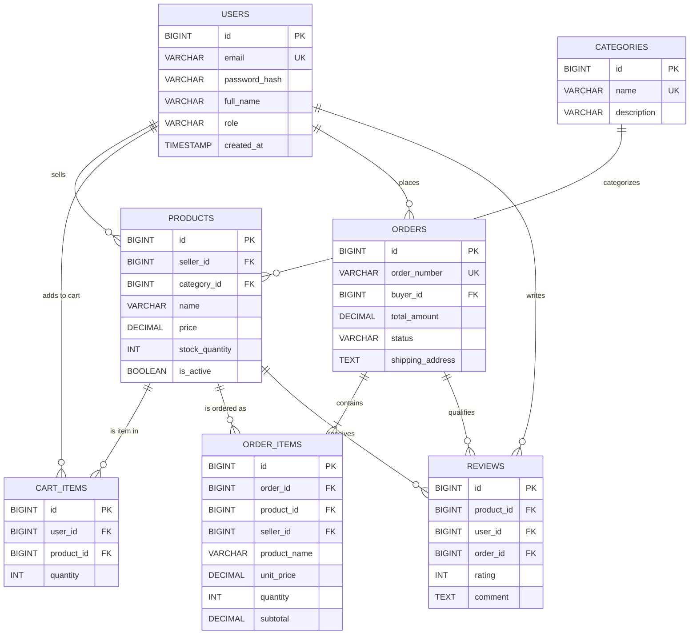
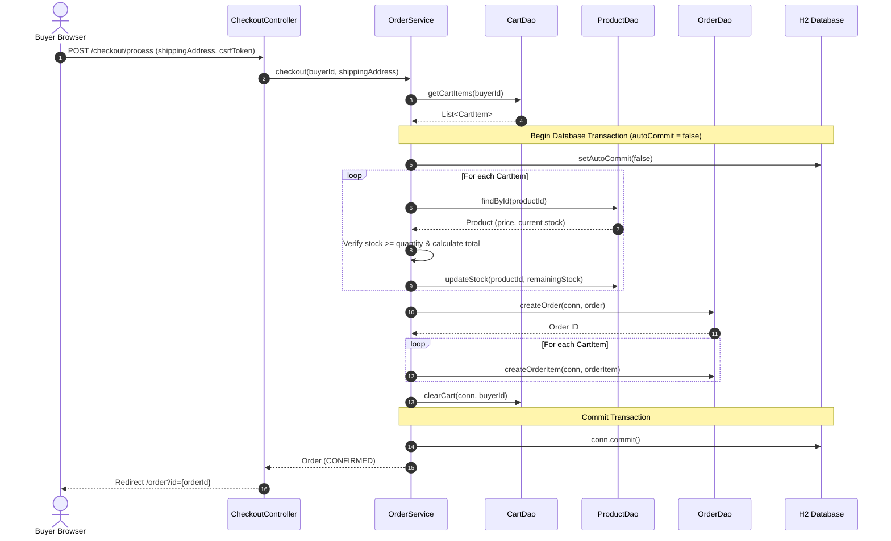

# OmegaMart Architecture & Design Specification (ARCHITECTURE.md)

**Project:** OmegaMart Multi-Vendor E-Commerce Platform  
**Target:** Anna University R2025 Third-Semester CSE Capstone Project  
**Stack:** Java 17, Java Servlets (Tomcat 9), JDBC, HikariCP, H2 Database, JSP/JSTL, JUnit 5

---

## 1. Architectural Layers & Separation of Concerns

OmegaMart is built upon a strict **Layered (N-Tier) Architecture** to ensure testability, maintainability, loose coupling, and clean separation of concerns.

```
┌─────────────────────────────────────────────────────────────┐
│                       Client Browser                        │
│             (HTML5, CSS3, JavaScript, Chat Widget)          │
└──────────────────────────────▲──────────────────────────────┘
                               │ HTTP / JSON
┌──────────────────────────────▼──────────────────────────────┐
│                    Presentation Layer                       │
│    • Servlets (Controllers)        • JSP & JSTL Views       │
│    • AuthFilter & CsrfFilter       • AppContextListener     │
└──────────────────────────────▲──────────────────────────────┘
                               │
┌──────────────────────────────▼──────────────────────────────┐
│                      Service Layer                          │
│    • AuthService                   • ProductService         │
│    • CartService                   • OrderService           │
│    • ReviewService                 • ChatService            │
└──────────────────────────────▲──────────────────────────────┘
                               │
┌──────────────────────────────▼──────────────────────────────┐
│                 Data Access Layer (DAO)                     │
│    • UserDao                       • ProductDao             │
│    • CategoryDao                   • CartDao                │
│    • OrderDao                      • ReviewDao              │
└──────────────────────────────▲──────────────────────────────┘
                               │ JDBC (PreparedStatements)
┌──────────────────────────────▼──────────────────────────────┐
│               Persistence & Database Layer                  │
│    • HikariCP Connection Pool      • Embedded H2 Database   │
└─────────────────────────────────────────────────────────────┘
```

### Layer Responsibilities:
1. **Controllers (`com.omega.omegamart.controller`)**:
   - Receive HTTP requests and extract/sanitize input parameters.
   - Delegate business operations to the Service layer.
   - Forward data to JSP views via request attributes or serialize JSON responses.
   - *Never execute SQL queries or implement business validation rules.*
2. **Filters & Listeners (`com.omega.omegamart.filter`, `listener`)**:
   - `AuthFilter`: Enforces Role-Based Access Control (RBAC) across `/buyer/*`, `/seller/*`, `/admin/*`.
   - `CsrfFilter`: Protects state-changing operations against Cross-Site Request Forgery.
   - `AppContextListener`: Controls startup lifecycle (pool initialization, schema creation, seed data loading) and graceful shutdown.
3. **Services (`com.omega.omegamart.service`)**:
   - Implement business logic, domain constraints, role checks, and transaction boundaries.
   - Enforce seller product ownership before updates or deletions.
   - Calculate order prices and subtotals on the server.
   - Execute ACID transactions for checkouts.
4. **Data Access Objects (`com.omega.omegamart.dao`)**:
   - Encapsulate all database interaction using ANSI SQL and `PreparedStatement`.
   - Guarantee prevention of SQL injection vulnerabilities.
   - Manage ResultSet mapping to domain models.
5. **Domain Models (`com.omega.omegamart.model`)**:
   - Plain Old Java Objects (POJOs) representing domain entities (`User`, `Product`, `Order`, `Review`, `Category`, `CartItem`).

---

## 2. Design Patterns Implemented

| Pattern | Purpose & Implementation Location | Trade-Offs & Rationale |
|---|---|---|
| **Data Access Object (DAO)** | `UserDao`, `ProductDao`, `OrderDao`, etc. Decouples business logic from SQL and database storage. | Slight boilerplate, but enables transparent mocking and DB swapping. |
| **Singleton** | `DatabaseConnectionPool`: Single shared HikariCP connection pool instance. | Prevents resource exhaustion from creating unmanaged connections across threads. |
| **Strategy** | `ChatProvider` interface implemented by `MockChatProvider` and `GeminiChatProvider`. | Allows switching between offline demo mock and live Gemini AI without altering controller logic. |
| **Front Controller / Servlet Routing** | `WebServlet` mapping conventions (`/cart/*`, `/seller/*`, `/products`). | Provides structured request dispatching without heavyweight frameworks like Spring WebMVC. |
| **Builder** | Used in `HttpClient.newBuilder()`, `HttpRequest.newBuilder()`, and HikariConfig. | Fluent, immutable configuration of complex networking objects. |

---

## 3. Database Entity-Relationship Diagram (ERD)



---

## 4. Place-Order Checkout Sequence Diagram (ACID Transaction)



---

## 5. System Use Case Diagram

```mermaid
flowchart TD
    subgraph Buyers
        B1["Browse Products & Search"]
        B2["Add to Cart & Manage Quantities"]
        B3["Perform Simulated Checkout"]
        B4["View Order History & Receipts"]
        B5["Submit Verified Purchase Reviews"]
        B6["Ask AI Chatbot FAQs"]
    end

    subgraph Sellers
        S1["List New Products"]
        S2["Edit & Update Own Product Listings"]
        S3["Delete / Deactivate Listings"]
        S4["View Orders Containing Seller's Items"]
    end

    subgraph Administrators
        A1["View Platform Metrics & Summary"]
        A2["Inspect Registered Users Directory"]
        A3["Moderate Inappropriate Products"]
        A4["Review Global Order Transactions"]
    end

    BuyerActor((Buyer)) --> B1
    BuyerActor --> B2
    BuyerActor --> B3
    BuyerActor --> B4
    BuyerActor --> B5
    BuyerActor --> B6

    SellerActor((Seller)) --> S1
    SellerActor --> S2
    SellerActor --> S3
    SellerActor --> S4

    AdminActor((Administrator)) --> A1
    AdminActor --> A2
    AdminActor --> A3
    AdminActor --> A4
```


